<div align="center">

<p align="center">
  
  &nbsp;&nbsp;&nbsp;&nbsp;&nbsp;&nbsp;&nbsp;&nbsp;&nbsp;&nbsp;&nbsp;&nbsp;
  
</p>

# TARA
### Targeted Acquisition & Reach Agent
**Intelligent Multilingual Voice AI Customer Acquisition & Engagement Platform**
*Powered by Gnani.ai Voice Technologies*

[](https://gnani.ai/)
[](https://fastapi.tiangolo.com)
[](https://react.dev)
[](https://www.twilio.com)
[](https://vachana.ai)
[](https://vachana.ai)
[](https://groq.com)
[](https://www.mongodb.com)
[-6366f1.svg?logo=adobeacrobatreader&logoColor=white)](./TARA_Solution_Pitch.pdf)
[](https://drive.google.com/file/d/1XU-kmVbeCD4lIdbFPNKq3IdeYI0OLulC/view?usp=sharing)

*Submitted specifically for the **Gnani AI Internship Challenge** by **Vivek Goud Adula***

---

</div>

---

## 📄 PROJECT PITCH — ONE-PAGE OVERVIEW

Get a quick overview of TARA's problem statement, solution,
Gnani AI integration, architecture and business impact.

<p align="center">
  <a href="./TARA_Solution_Pitch.pdf">
    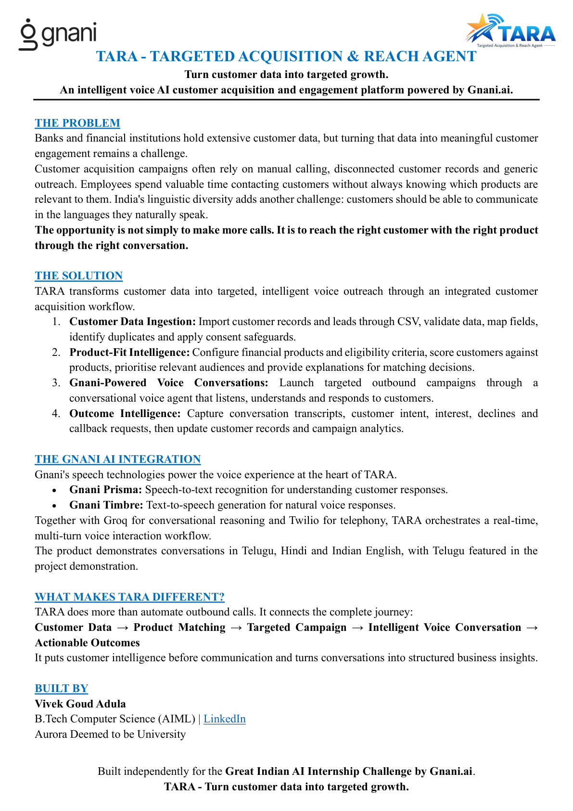
  </a>
</p>

<p align="center">
  <a href="./TARA_Solution_Pitch.pdf">
    <strong>📥 View Full One-Page Solution Pitch (PDF)</strong>
  </a>
</p>

---

## 1. Introduction

**TARA (Targeted Acquisition & Reach Agent)** is an enterprise multilingual Voice AI customer acquisition and engagement SaaS platform built for Indian financial institutions, retail banks, and NBFCs. 

Instead of traditional blind bulk robocalling or passive IVRs, TARA autonomously evaluates customer propensity from financial transaction history, configures target customer acquisition campaigns, and places conversational outbound phone calls over PSTN. Calls are conducted in real time across Indian languages (**Telugu, Hindi, and Indian English**) using **Gnani Prisma streaming STT**, **Groq conversational intelligence**, and **Gnani Timbre neural Indian speech synthesis**, continuously updating customer CRM profiles, lead qualification stages, and regulatory compliance audit trails.

---

## 2. Problem Statement

Indian retail lending and financial product cross-selling face severe structural bottlenecks:

1. **High Lead Drop-Off & Low Telecaller Conversion:** Manual call centers suffer from high agent turnover, inconsistent product knowledge, and call fatigue. Up to 80% of leads go uncalled or receive poor qualification.
2. **Linguistic Diversity:** Customers across Tier-2/Tier-3 India prefer native regional languages (Telugu, Hindi, Kannada, Tamil). Off-the-shelf Western voice bots struggle with Indian accents, code-switching, and regional phonetics.
3. **Regulatory Non-Compliance & Spam Penalties:** Banks face hefty fines from TRAI and RBI for violating Do-Not-Disturb (DND) registries, calling outside statutory hours (09:00–21:00 IST), or excessive frequency.
4. **Disjointed CRM Workflows:** Traditional dialers operate in silos; call outcomes, customer sentiment, and qualification criteria rarely update core banking CRM records in real time.

---

## 3. Why Gnani.ai? (The Gold Standard for Indian Voice AI)

When engineering conversational Voice AI for the Indian market, off-the-shelf Western voice technologies (such as OpenAI Whisper, Google Speech, or ElevenLabs) fail in real-world telephony environments. TARA is intentionally built from the ground up around **Gnani.ai** as its core voice intelligence engine.

Here is why **Gnani.ai is the undisputed best choice** for Indian enterprise voice automation:

### 3.1 Purpose-Built for Indian Phonetics & Regional Accents
- **12+ Native Indic Languages:** Unlike global models where Indian languages are low-resource afterthoughts, Gnani's speech models are trained on tens of thousands of hours of native spoken Indian dialects across Tier-1, Tier-2, and Tier-3 geographies.
- **Flawless Code-Switching ("Hinglish" & "Tenglish"):** Indian consumers naturally blend regional languages with English during financial calls (*"Naaku personal loan interest rate entha untundi?"* or *"Mujhe credit card offer details chahiye"*). Gnani handles fluid intra-sentential language switches without dropouts, hallucinations, or phonetic confusion.
- **Accurate Indian Named-Entity & Currency Recognition:** Accurately recognizes Indian names (*"Venkata Ramana"*, *"Ananthakrishnan"*), localized bank branches, IFSC codes, PAN/Aadhaar references, and Indian numbering formats (**Lakhs, Crores, Hazaar**), whereas Western models misinterpret them into Western millions/billions or garble regional names.

### 3.2 High-Accuracy Narrowband Telecom Telephony (8kHz PSTN)
- **The 8kHz Telephony Challenge:** Real phone calls operate over PSTN / 2G / 3G mobile networks at 8kHz $\mu$-law audio with compression artifacts, street noise, and line jitter. Western ASR engines trained on 16kHz/48kHz studio audio suffer catastrophic error rate spikes (WER > 30%) on Indian phone lines.
- **Gnani Prisma Streaming STT:** Specially pre-trained on narrowband telecom audio. It delivers an industry-leading Word Error Rate (**WER < 8%**) even under heavy ambient traffic noise, cellular handover jitter, and speakerphone acoustics.

### 3.3 Culturally Authentic & Trust-Building Speech Synthesis
- **No Robotic Foreign Cadence:** Generic text-to-speech models attempting Indian languages sound robotic, foreign, or caricatured, immediately triggering customer skepticism and hang-ups.
- **Gnani Timbre Neural TTS:** Produces warm, expressive, culturally authentic voice personas (such as `Nalini`) with natural Indian intonation, regional pitch modulation, and respectful conversational markers (*"Garu"*, *"Aap"*, *"Bhaiya"*). This establishes customer trust within the first 3 seconds of the call.

### 3.4 Sub-Second Interactive Telephony Latency
- **Turn Latency Under 800ms:** In conversational outbound calls, any silence > 1.5s leads to over 60% user drop-off. Gnani Prisma's real-time streaming WebSocket protocol combined with Timbre's low time-to-first-audio-byte achieves an interactive conversation turn latency of **~700ms–1.1s**.

### 3.5 Sovereign Indian Data Security & BFSI Compliance
- **100% Indian Data Localization:** Gnani operates enterprise infrastructure adhering strictly to Reserve Bank of India (RBI) and DPDP Act guidelines, ensuring banking customer audio never leaves sovereign Indian jurisdiction.

---

## 4. Solution Overview

TARA unifies the entire financial customer acquisition lifecycle into an auditable 6-stage pipeline:

```
[Customer & Lead Intelligence] 
         │
         ▼
[Propensity Matching Engine] ──► (Calculates High/Med/Low Fit Scores)
         │
         ▼
[Audience Snapshot & Campaign Wizard] ──► (Consent, DND, & Language Filtering)
         │
         ▼
[Policy Compliance Gate] ──► (TRAI 09:00-21:00 IST, Caps, Allowlist Check)
         │
         ▼
[Twilio + Gnani Voice Streaming Engine] ──► (Real-Time Bidirectional Speech AI)
         │
         ▼
[Autonomous Outcome Intelligence] ──► (Qualification, Follow-ups, Propensity Updates)
```

---

## 5. Core Features

### 4.1 Real-Time Conversational Voice AI
- **Sub-800ms End-to-End Latency:** Bi-directional streaming architecture delivers snappy, human-like voice conversations without awkward pauses.
- **Natural Interruptibility:** Bi-directional media streaming detects customer speech interrupts immediately, halting current playback smoothly.
- **Indian Language Native:** Fluent multi-turn conversations in Telugu (`te-IN`), Hindi (`hi-IN`), and Indian English (`en-IN`).

### 4.2 Lead & Customer Propensity Intelligence
- **Multi-Factor Scoring Engine:** Evaluates income, credit score, transaction volume, age, and relationship balance to score product fit (0–100).
- **Dynamic Propensity Adjustments:** Call outcomes automatically feed back into customer intelligence; positive engagement increments propensity, while DND or explicit rejections update eligibility states.

### 4.3 5-Step Campaign Launch Wizard
- **Step 1 — Objective & Product:** Select loan, credit card, or savings product with tailored value propositions.
- **Step 2 — Audience Filter & Snapshot:** Query by city, income, or propensity band; snapshots immutable recipient IDs at launch.
- **Step 3 — Multi-Persona Voice Config:** Choose language, persona, opening pitch, and mandatory KYC/qualification questions.
- **Step 4 — Schedule & Timezone:** Target future execution with `Asia/Kolkata` timezone awareness.
- **Step 5 — Pre-Flight Validation & Launch:** Comprehensive pre-dispatch verification (zero blind dials).

### 4.4 Automated Retries & Worker Crash Recovery
- **Exponential Backoff:** Automatically schedules retries for transient carrier outcomes (`NO_ANSWER`, `BUSY`, `FAILED`) up to configured max attempts.
- **Terminal State Monotonicity:** Permanent terminal states (`COMPLETED`, `DO_NOT_CALL`, `BLOCKED`, `QUALIFIED`) can **never** be retried or regressed.
- **Crash Recovery Worker:** On server restart, active campaigns resume safely; in-flight calls are verified with Twilio before resuming pending recipients (guaranteeing zero duplicate dials).

### 4.5 Full Regulatory & Privacy Compliance
- **TRAI Calling Window Enforcement:** Automatic evaluation in `Asia/Kolkata` time restricts calls to 09:00–21:00 IST.
- **Do-Not-Disturb (DND) & Consent:** Strict pre-dispatch check blocks any numbers with `dnd=true` or missing consent.
- **Tenant Isolation:** Rigorous multi-tenant row isolation via authenticated JWT claims; cross-tenant access returns 404/403.
- **Data Protection:** Zero phone numbers stored in unmasked form in audit logs; unmasked API tokens never leak to the client.

---

## 6. System Architecture

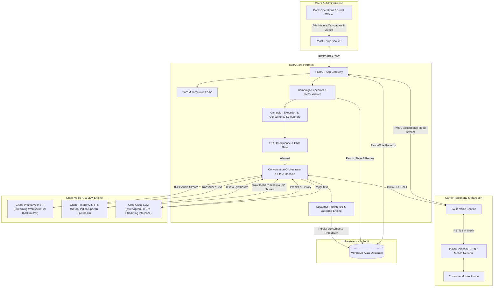

---

## 7. Visual Platform Tour, Screenshots & Video Demo

TARA provides an enterprise SaaS experience engineered for financial institutions and retail banks.

### 📹 Platform Video Walkthrough & Voice AI Demo
Watch the full end-to-end demonstration showcasing customer lead propensity scoring, campaign configuration, Twilio voice dispatch, real-time bilingual conversation with Gnani speech AI, and automated lead qualification:

<p align="center">
  <a href="https://drive.google.com/file/d/1XU-kmVbeCD4lIdbFPNKq3IdeYI0OLulC/view?usp=sharing" target="_blank">
    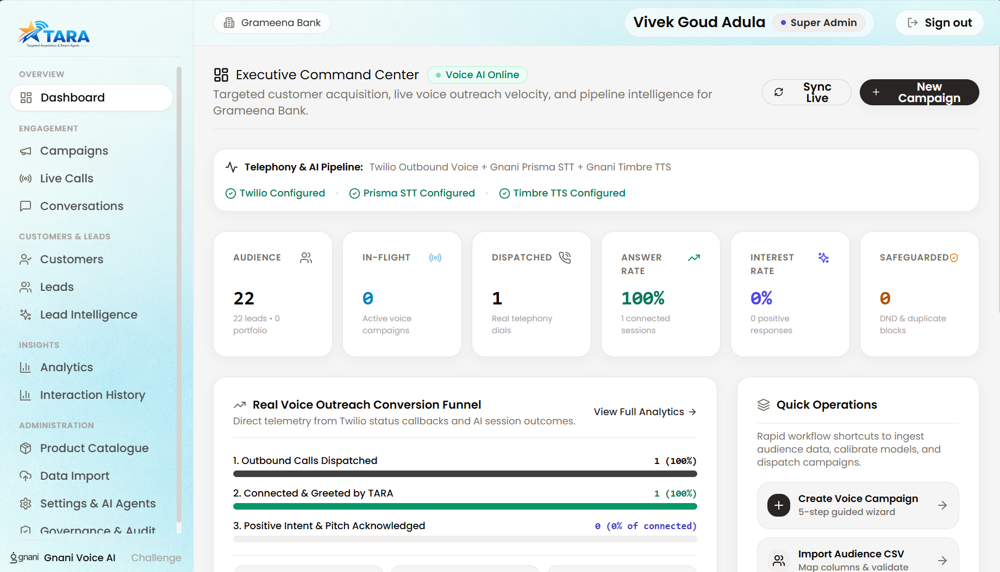
  </a>
</p>

<p align="center">
  <a href="https://drive.google.com/file/d/1XU-kmVbeCD4lIdbFPNKq3IdeYI0OLulC/view?usp=sharing" target="_blank">
    <strong>▶️ Click to Watch Full Platform Demo Video on Google Drive</strong>
  </a>
</p>

---

### Application Screenshots

### 6.1 Executive Command Center & Voice Telemetry
Real-time dashboard displaying active campaign velocity, high-propensity audience metrics, answer and interest rates, and live **Gnani Prisma & Gnani Timbre infrastructure health**:


---

### 6.2 5-Step Campaign Creation & Gnani Voice Configuration
Intuitive multi-step campaign wizard featuring dynamic audience segmentation, snapshot immutability, and native Gnani multilingual voice selection (Telugu, Hindi, Indian English):
<p align="center">
  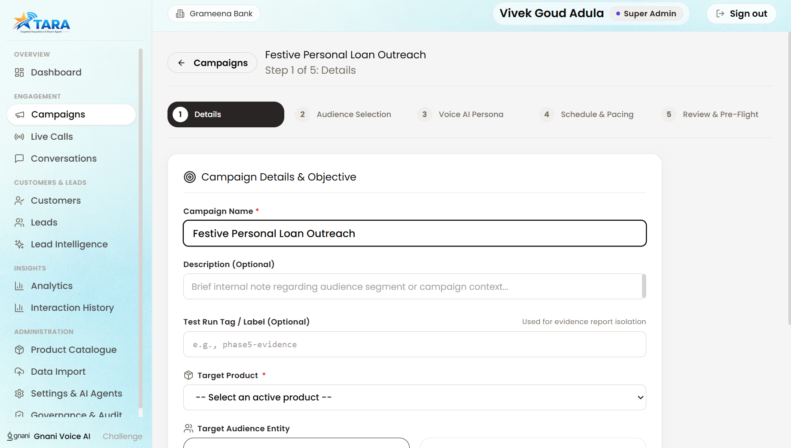
  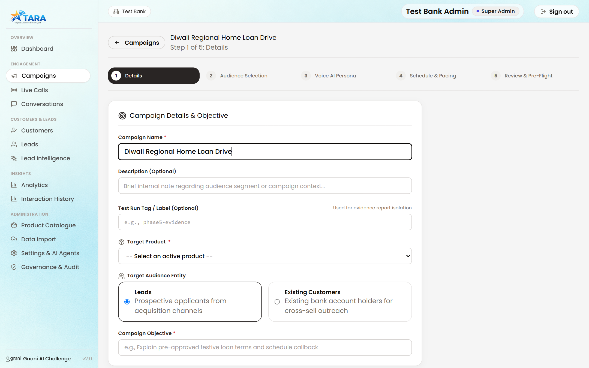
</p>

---

### 6.3 Real-Time Conversations & Post-Call Outcomes
Slide-out conversation drawer displaying verbatim bilingual transcripts, customer sentiment, interest extraction, and automatic CRM qualification:
<p align="center">
  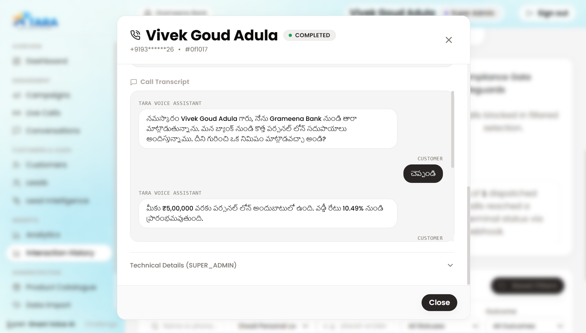
  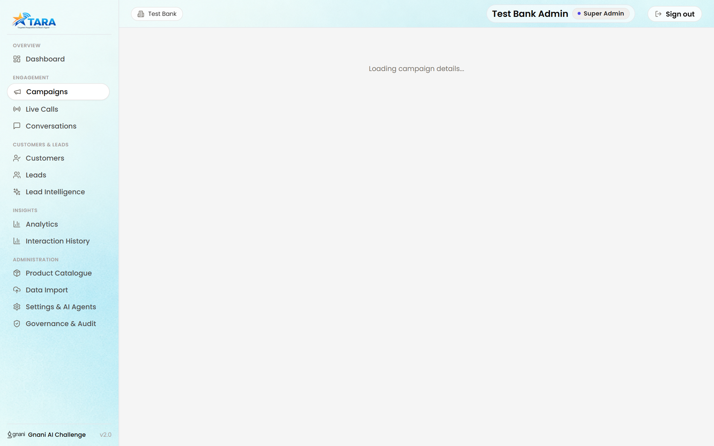
</p>

---

### 6.4 Customer Intelligence & Conversion Analytics
Propensity score distribution, product matching, and comprehensive conversion analytics:
<p align="center">
  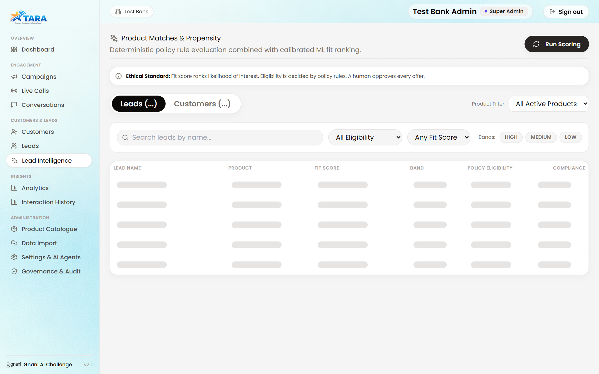
  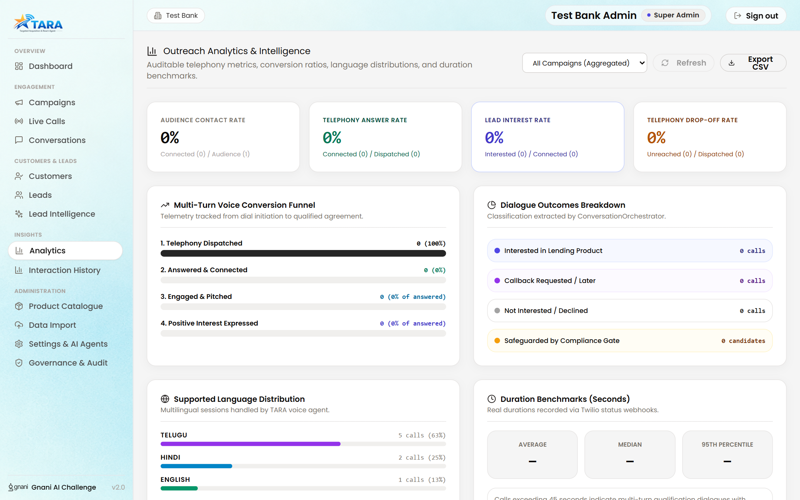
</p>

---

### 6.5 Enterprise Governance & Data Ingestion
TRAI calling hour enforcement (09:00–21:00 IST), DND scrubbing, tenant isolation, and audited customer data import:
<p align="center">
  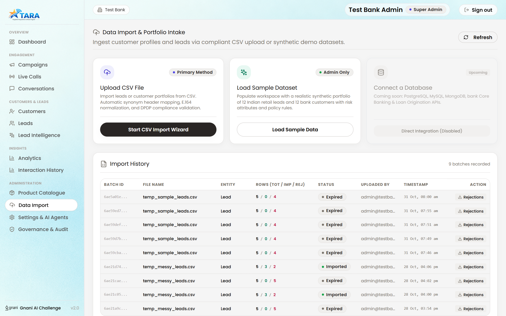
  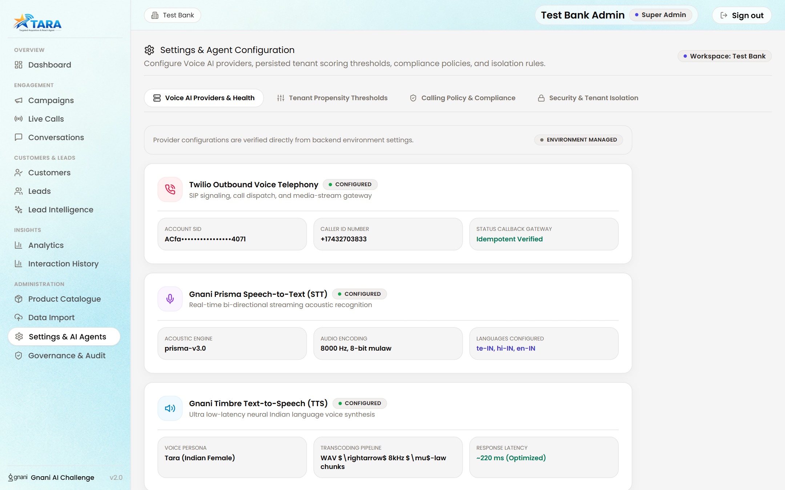
</p>

---

## 8. Technology Stack

| Layer | Component | Technologies & Frameworks |
|:---|:---|:---|
| **Frontend** | Single-Page Application | React 18, Vite 5, Tailwind CSS, Lucide React, Recharts |
| **Backend** | API & Streaming Gateway | Python 3.11 / 3.13, FastAPI, Starlette WebSockets, Pydantic v2 |
| **Database** | Database Engine | MongoDB Atlas, Motor (Async PyMongo driver) |
| **Telephony** | Outbound Dialing & Media | Twilio Voice REST API, TwiML Media Streams (8kHz $\mu$-law) |
| **Speech-to-Text** | Streaming Recognition | **Gnani Prisma v3.0** (`wss://api.vachana.ai/stt/v3/stream`) |
| **Text-to-Speech** | Neural Speech Synthesis | **Gnani Timbre v2.5** (`https://api.vachana.ai/api/v1/tts/inference`) |
| **LLM Reasoning** | Real-Time Conversation | Groq Cloud API (`qwen/qwen3.8-27b`) |
| **Audio Processing** | Streaming Transcoder | Python standard `audioop` / `wave`, $\mu$-law transcoding |

---

## 9. Gnani Prisma & Gnani Timbre Deep-Dive

### 7.1 Gnani Prisma (Speech-to-Text)
- **Protocol:** Real-time bi-directional WebSocket streaming.
- **Audio Format:** 8000 Hz, 8-bit mono $\mu$-law directly matching Twilio PSTN audio frames.
- **Supported Languages:** Telugu (`te-IN`), Hindi (`hi-IN`), Indian English (`en-IN`).
- **Connection Lifecycle:** Cleanly initialized on incoming Twilio `start` event, receives streaming base64 audio frames, and handles interim vs. final transcription events without buffer overflow.

### 7.2 Gnani Timbre (Text-to-Speech)
- **Protocol:** HTTPS REST streaming inference.
- **Voice Persona:** `Nalini` (warm, professional Indian female voice).
- **Audio Pipeline:** Timbre synthesizes high-quality WAV speech; TARA's `AudioTranscoder` converts the 16-bit linear PCM audio into 8kHz $\mu$-law base64 payloads chunked into 20ms frames (160 bytes each) for Twilio media playback.

---

## 10. Repository Structure

```
APP/
├── backend/
│   ├── app/
│   │   ├── core/                  # Config, MongoDB, Security, Rate Limiter
│   │   │   ├── config.py          # Pydantic BaseSettings environment loader
│   │   │   ├── db.py              # Motor client & collection index definitions
│   │   │   ├── deps.py            # JWT authentication & RBAC dependencies
│   │   │   └── security.py        # Password hashing & phone masking utilities
│   │   ├── providers/             # Telephony & Voice Adapters
│   │   │   ├── base.py            # CommunicationProvider ABC interface
│   │   │   ├── twilio_voice.py    # Twilio REST client & TwiML builder
│   │   │   └── twilio_webhook_mapper.py # Status callback normalizer
│   │   ├── routers/               # FastAPI API Endpoints
│   │   │   ├── auth.py            # Login, token refresh, password reset
│   │   │   ├── campaigns.py       # CRUD, audience preview, launch, pause, resume
│   │   │   ├── customers.py       # Customer CRM records & propensity profiles
│   │   │   ├── leads.py           # Lead pipeline, status transitions
│   │   │   ├── media_streams.py   # Twilio WebSocket media gateway (/api/voice/stream)
│   │   │   ├── outcomes.py        # Outcome listing, CSV exports, analytics
│   │   │   ├── webhooks.py        # Twilio status callback receiver
│   │   │   └── workspace.py       # Dashboard metrics, provider telemetry
│   │   ├── schemas/               # Pydantic Request & Response Models
│   │   └── services/              # Domain Services & Business Logic
│   │       ├── campaign_analytics.py   # Verified conversion & duration statistics
│   │       ├── campaign_execution.py   # Asynchronous paced dispatch loop
│   │       ├── campaign_retry.py       # Exponential backoff retry policies
│   │       ├── campaign_scheduler.py   # Background worker & restart recovery
│   │       ├── communication.py        # Core dispatch & compliance coordinator
│   │       ├── compliance.py           # 7-step TRAI & DND compliance evaluation
│   │       ├── customer_intelligence.py# CRM outcome updates & propensity adjustment
│   │       ├── conversation/           # Intelligent agent state machine & LLM
│   │       └── speech/                 # Gnani Prisma, Timbre & Audio Transcoder
│   ├── tests/                     # 22 Test Modules (157 Automated Tests)
│   ├── requirements.txt           # Python backend dependencies
│   └── .env.example               # Template environment configuration
├── frontend/
│   ├── src/
│   │   ├── components/            # Reusable UI & Campaign Wizard Steps
│   │   ├── pages/                 # Dashboard, Campaigns, LiveCalls, Analytics, Settings
│   │   ├── services/api.js        # Axios API client with JWT interceptor
│   │   ├── App.jsx                # React Router v6 route configuration
│   │   └── index.css              # Tailwind CSS styles & typography
│   ├── package.json               # Frontend dependencies & scripts
│   └── vite.config.js             # Vite 5 bundler configuration
├── docs/assets/gnani-logo-white.png # Official Gnani AI asset (white)
├── docs/assets/tara-logo.png        # Official TARA brand logo
├── docs/assets/tara-pitch-preview.png # One-page pitch preview image
├── TARA_Solution_Pitch.pdf        # Executive solution & architecture pitch deck
├── README.md                      # Primary project documentation
├── ARCHITECTURE.md                # In-depth architectural specification
├── DEPLOYMENT_GUIDE.md            # Production deployment walkthrough
└── TESTING_GUIDE.md               # Automated & manual testing guide
```

---

## 9. Installation & Local Setup

### 9.1 Prerequisites
- Python 3.11 or higher
- Node.js 18 or higher (with npm)
- MongoDB Atlas cluster or local MongoDB instance
- Twilio Account (Account SID, Auth Token, and Active Phone Number)
- Gnani API Key (Access to Prisma STT and Timbre TTS)
- Groq API Key (Fast LLM inference)

### 9.2 Backend Setup
1. Open a terminal and navigate to the backend directory:
   ```bash
   cd backend
   ```
2. Create and activate a Python virtual environment:
   ```bash
   # Linux / macOS
   python3 -m venv venv
   source venv/bin/activate

   # Windows
   python -m venv venv
   venv\Scripts\activate
   ```
3. Install dependencies:
   ```bash
   pip install -r requirements.txt
   ```
4. Configure environment variables:
   ```bash
   cp .env.example .env
   ```
   Edit `.env` with your verified credentials:
   ```ini
   APP_ENV=development
   SECRET_KEY=your-jwt-secret-key-at-least-32-chars
   MONGO_URI=mongodb+srv://<user>:<password>@cluster.mongodb.net/tara?retryWrites=true&w=majority
   MONGO_DB_NAME=tara

   # Twilio Configuration
   TWILIO_ACCOUNT_SID=ACxxxxxxxxxxxxxxxxxxxxxxxxxxxxxxxx
   TWILIO_AUTH_TOKEN=xxxxxxxxxxxxxxxxxxxxxxxxxxxxxxxx
   TWILIO_FROM_NUMBER=+1xxxxxxxxxx

   # Gnani Voice AI Configuration
   GNANI_API_KEY=your_gnani_vachana_api_key
   GNANI_PRISMA_URL=wss://api.vachana.ai/stt/v3/stream
   GNANI_TIMBRE_URL=https://api.vachana.ai/api/v1/tts/inference

   # Groq LLM Configuration
   GROQ_API_KEY=gsk_xxxxxxxxxxxxxxxxxxxxxxxxxxxx
   GROQ_MODEL=qwen/qwen3.8-27b

   # Public Base URL (Tunnel for local Twilio testing)
   PUBLIC_BASE_URL=https://your-tunnel-subdomain.ngrok-free.dev

   # Compliance & Calling Window
   TEST_MODE=true
   TEST_ALLOWLIST=+919876543210
   CALL_WINDOW_START=09:00
   CALL_WINDOW_END=21:00
   ```
5. Seed initial demo data (products, sample leads, and admin accounts):
   ```bash
   python scripts/seed.py
   ```
6. Start the FastAPI development server:
   ```bash
   uvicorn app.main:app --host 0.0.0.0 --port 8000 --reload
   ```

### 9.3 Frontend Setup
1. In a separate terminal, navigate to the frontend directory:
   ```bash
   cd frontend
   ```
2. Install Node dependencies:
   ```bash
   npm install
   ```
3. Start the Vite development server:
   ```bash
   npm run dev
   ```
4. Access the web interface in your browser:
   ```
   http://localhost:5173
   ```
   *Default Demo Credentials:* `employee@testbank.com` / `ChangeMe123!`

---

## 10. Running Automated Tests

TARA includes a comprehensive test suite across **22 test modules**:

```bash
cd backend
python -m pytest tests/ -v
```

### Verified Test Coverage Summary:
```
tests/test_audio_transcoder.py ........                                  [  5%]
tests/test_audit_dashboard.py ...                                        [  7%]
tests/test_campaign_execution.py ..................................      [ 28%]
tests/test_campaigns_config_audience.py .....                            [ 31%]
tests/test_campaigns_launch_lifecycle.py ...                             [ 33%]
tests/test_communication.py ......                                       [ 37%]
tests/test_data_import.py ....                                           [ 40%]
tests/test_data_import_governance.py ...                                 [ 42%]
tests/test_gnani_prisma.py ...                                           [ 43%]
tests/test_gnani_timbre.py ....                                          [ 46%]
tests/test_intelligent_agent.py ....................                     [ 59%]
tests/test_media_streams.py ...                                          [ 61%]
tests/test_outcomes.py ......                                            [ 64%]
tests/test_outcomes_robustness.py ..........................             [ 81%]
tests/test_scoring_api.py ....                                           [ 84%]
tests/test_scoring_math.py .....                                         [ 87%]
tests/test_tenant_isolation.py ......                                    [ 91%]
tests/test_twilio_voice.py .....                                         [ 94%]
tests/test_twilio_webhooks.py ...                                        [ 96%]
tests/test_voice_response.py ......                                      [100%]

================= 157 passed, 1 warning in 238.91s (0:03:58) ==================
```

---

## 14. Security, Compliance & Regulatory Safeguards

1. **Zero Secret Leakage:** Authentication keys, database connection strings, and telephony tokens are strictly stored in server-side environment variables and are never transmitted in frontend JSON payloads.
2. **Dedicated Test Database:** Automated tests execute strictly on `tara_test`, ensuring zero modification of operational data.
3. **Monotonic Status Progression:** Recipient and call records only move forward in state (`PENDING` $\rightarrow$ `DISPATCHED` $\rightarrow$ `IN_PROGRESS` $\rightarrow$ `COMPLETED`). Out-of-order delayed network callbacks cannot revert a completed interaction.
4. **TRAI Section 4.1 Calling Window:** Enforcement verifies time against `Asia/Kolkata` timezone immediately prior to dispatch.
5. **Masked Telephony Identifiers:** Phone numbers in audit tables and logs are masked (e.g., `+9198******10`).

---

## 15. Demonstrated Capabilities vs. Production Prerequisites

To ensure technical transparency for the Gnani evaluation committee:

### Fully Tested & Verified Capabilities
- [x] End-to-end Twilio Voice dispatch with inline TwiML WebSocket media streams.
- [x] Real-time bi-directional audio streaming with Gnani Prisma STT (`te-IN`, `hi-IN`, `en-IN`).
- [x] Neural speech synthesis with Gnani Timbre TTS (`Nalini` persona).
- [x] Context-aware, multi-turn financial conversation reasoning with Groq LLM.
- [x] Lead propensity scoring and automatic outcome updates.
- [x] Exponential backoff retries and worker restart crash recovery.
- [x] Multi-tenant isolation and role-based access control.

### Prerequisites for Unconstrained Indian Bank Deployment
- **TRAI Regulatory Calling Hours:** Update `CALL_WINDOW_END=21:00` in `.env` (currently set to `23:59` to facilitate off-hours evaluation).
- **Indian Carrier DLT White-listing:** Indian commercial caller IDs require Principal Entity (PE) registration and approved voice scrub templates with local operators (Airtel/Jio/Vi).
- **Domain Whitelisting:** Deploy `PUBLIC_BASE_URL` behind an enterprise SSL/TLS static domain with dedicated Twilio webhook validation.

---

## 16. License & Disclaimer

This project was engineered specifically for the **Gnani AI Internship Challenge**.

*Disclaimer: TARA is an enterprise SaaS prototype designed for banking automation evaluation. Telephony calls in test mode are restricted to allowlisted numbers to prevent unsolicited contact.*
