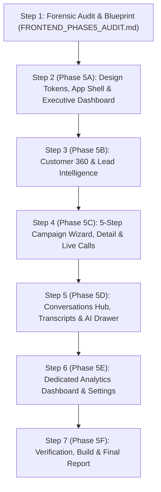

# TARA 2.0 — Phase 5 Frontend Forensic Audit & Architectural Blueprint
**Document Status:** Complete Forensic Audit  
**Date:** November 2026  
**System:** TARA 2.0 (Targeted Acquisition & Reach Agent)  
**Scope:** Frontend Architecture, Backend API Contracts, Gap Analysis & Implementation Roadmap  

---

## Executive Summary

This forensic audit evaluates the entire frontend application and its alignment with the existing FastAPI backend services for TARA 2.0. The audit inspects all React components, routing configurations, styling tokens, API interceptors, backend endpoints, and data contracts to establish the complete roadmap for **Phase 5: Frontend, Analytics & Complete Product Experience**.

TARA 2.0 already possesses a robust, verified backend engine (Phases 1–4, with 156/156 passing tests, Twilio telephony, Gnani Prisma STT, Gnani Timbre TTS, compliance gating, automatic retries, and crash recovery). The objective of Phase 5 is to refine and expand the frontend into an enterprise-grade, cohesive Voice AI customer acquisition and engagement SaaS platform.

---

## 1. Existing Frontend Pages & Component Hierarchy

### 1.1 Directory Structure
```
frontend/
├── index.html                     # HTML shell, EB Garamond & Inter typography links
├── package.json                   # React 18, Vite 5.4.21, React Router v6, Lucide React, Tailwind
├── tailwind.config.js             # Design tokens: canvas, ink, surface, hairline, orb gradients
├── src/
│   ├── main.jsx                   # React DOM root render
│   ├── App.jsx                    # Top-level BrowserRouter and Route declarations
│   ├── index.css                  # Tailwind directives and editorial typography utility classes
│   ├── api/
│   │   └── client.js              # Fetch wrapper with Bearer token injection and 401 redirect
│   ├── auth/
│   │   ├── AuthContext.jsx        # JWT state, user info, login/logout handlers
│   │   └── ProtectedRoute.jsx     # Route guards (ProtectedRoute & PublicAuthRoute)
│   ├── components/
│   │   ├── Badge.jsx              # Status badge with semantic colored dot
│   │   ├── Button.jsx             # Button component (primary, outline, text)
│   │   ├── Card.jsx               # Surface card with hairline border and soft shadow
│   │   ├── DataTable.jsx          # Paginated table with skeleton loader and empty states
│   │   ├── Input.jsx              # Standard form input with label and helper text
│   │   ├── Layout.jsx             # App shell: sidebar navigation, topbar, tenant banner
│   │   ├── Modal.jsx              # Centered dialog box portaled to document.body
│   │   ├── ProductMatchesFilterBar.jsx
│   │   ├── ProductMatchesSection.jsx
│   │   ├── campaigns/
│   │   │   ├── WizardStep1Details.jsx
│   │   │   ├── WizardStep2Audience.jsx
│   │   │   ├── WizardStep3VoiceConfig.jsx
│   │   │   ├── WizardStep4ReviewLaunch.jsx
│   │   │   └── WizardNonVoiceConfigs.jsx
│   │   ├── dashboard/
│   │   │   ├── DashboardMetrics.jsx
│   │   │   ├── GettingStartedChecklist.jsx
│   │   │   └── RecentActivity.jsx
│   │   ├── import/
│   │   │   ├── CsvImportWizard.jsx
│   │   │   ├── ImportHistoryTable.jsx
│   │   │   ├── OptionCards.jsx
│   │   │   ├── StepColumnMapping.jsx
│   │   │   ├── StepPreviewAndConfirm.jsx
│   │   │   └── StepTypeAndUpload.jsx
│   │   ├── landing/               # Public marketing landing page components
│   │   └── outcomes/
│   │       ├── CallDetailDrawer.jsx
│   │       ├── EvidencePanel.jsx
│   │       ├── OutcomesDistribution.jsx
│   │       ├── OutcomesFilterBar.jsx
│   │       └── OutcomesSummaryCards.jsx
│   ├── pages/
│   │   ├── Auth.jsx
│   │   ├── CampaignDetail.jsx
│   │   ├── Campaigns.jsx
│   │   ├── CampaignWizard.jsx
│   │   ├── Customers.jsx
│   │   ├── Dashboard.jsx
│   │   ├── DataImport.jsx
│   │   ├── ExplainableAI.jsx
│   │   ├── Governance.jsx
│   │   ├── Landing.jsx
│   │   ├── Leads.jsx
│   │   ├── LiveMonitor.jsx
│   │   ├── Login.jsx
│   │   ├── Models.jsx
│   │   ├── NotFound.jsx
│   │   ├── Outcomes.jsx
│   │   ├── ProductMatches.jsx
│   │   ├── Products.jsx
│   │   └── Signup.jsx
│   └── utils/
│       └── format.js              # Formatting helpers: currency, language, segment, date
```

---

## 2. Existing Backend API Endpoints & Contracts

All backend routers located in `backend/app/routers/` provide clean, tenant-isolated REST APIs:

| Category | Endpoint | Method | Response / Purpose |
| :--- | :--- | :--- | :--- |
| **Auth** | `/api/auth/login` | `POST` | Issues JWT token, tenant information, user role |
| **Auth** | `/api/auth/signup` | `POST` | Registers new tenant admin user |
| **Auth** | `/api/auth/me` | `GET` | Returns currently authenticated user context |
| **Workspace** | `/api/workspace/dashboard` | `GET` | High-level summary counts, recent activities |
| **Workspace** | `/api/workspace/sample-data` | `POST` | Generates compliant synthetic demo leads/customers |
| **Customers** | `/api/customers` | `GET` | Paginated customer records with filters (search, language, consent, DND) |
| **Customers** | `/api/customers/{id}` | `GET` | Full customer profile and financial standing |
| **Customers** | `/api/customers/{id}/matches` | `GET` | Product matches, propensity bands, policy eligibility |
| **Leads** | `/api/leads` | `GET` | Paginated lead records with filters |
| **Leads** | `/api/leads/{id}` | `GET` | Full lead profile and attributes |
| **Leads** | `/api/leads/{id}/matches` | `GET` | Lead product scoring and eligibility |
| **Products** | `/api/products` | `GET` | Active product catalogue with eligibility rules |
| **Products** | `/api/products/{id}` | `GET`, `PUT` | Product CRUD and rule definitions |
| **Products** | `/api/products/{id}/active` | `PATCH` | Toggle product active status |
| **Scoring** | `/api/scoring/run` | `POST` | Executes ML propensity scoring batch |
| **Scoring** | `/api/scoring/runs` | `GET` | History of scoring runs |
| **Scoring** | `/api/matches` | `GET` | Scored matches with explainability reason codes |
| **Scoring** | `/api/matches/summary` | `GET` | Score band distribution (High, Medium, Low) |
| **Scoring** | `/api/models` | `GET` | Model governance cards and feature weights |
| **Campaigns** | `/api/campaigns` | `GET`, `POST` | Campaign list (status filters) and creation |
| **Campaigns** | `/api/campaigns/{id}` | `GET`, `PUT`, `DELETE` | Campaign detail and metadata update |
| **Campaigns** | `/api/campaigns/{id}/audience/preview` | `GET` | Candidate recipients preview |
| **Campaigns** | `/api/campaigns/{id}/audience` | `PUT` | Snapshot candidate audience into campaign |
| **Campaigns** | `/api/campaigns/{id}/recipients` | `GET` | Paginated campaign recipients with call status |
| **Campaigns** | `/api/campaigns/{id}/config/{channel}` | `PUT` | Save channel configuration (voice prompt, language, questions) |
| **Campaigns** | `/api/campaigns/{id}/preview` | `POST` | Live voice prompt assembly and compliance preview |
| **Campaigns** | `/api/campaigns/{id}/validate` | `POST` | Pre-flight validation report (dialability, blocked counts) |
| **Campaigns** | `/api/campaigns/{id}/schedule` | `POST` | Schedule campaign for designated start time |
| **Campaigns** | `/api/campaigns/{id}/launch` | `POST` | Launch campaign execution immediately |
| **Campaigns** | `/api/campaigns/{id}/pause` | `POST` | Pause in-flight campaign |
| **Campaigns** | `/api/campaigns/{id}/resume` | `POST` | Resume paused campaign |
| **Campaigns** | `/api/campaigns/{id}/cancel` | `POST` | Cancel campaign |
| **Campaigns** | `/api/campaigns/{id}/retry` | `POST` | Queue retry for failed / no-answer recipients |
| **Campaigns** | `/api/campaigns/{id}/progress` | `GET` | Real-time counts by status and compliance breakdown |
| **Campaigns** | `/api/campaigns/{id}/analytics` | `GET` | Full campaign analytics: contact, answer, qualification rates, durations |
| **Campaigns** | `/api/campaigns/{id}/retries` | `GET` | Retry queue status and pending retries |
| **Campaigns** | `/api/campaigns/{id}/calls` | `GET` | Communications dispatched under this campaign |
| **Outcomes** | `/api/outcomes/summary` | `GET` | Aggregated telephony and voice conversion statistics |
| **Outcomes** | `/api/outcomes/calls` | `GET` | Searchable list of call records with outcomes |
| **Outcomes** | `/api/outcomes/calls/{id}` | `GET` | Single call record with transcript, timeline, extraction |
| **Communications**| `/api/communications` | `GET` | Scoped communication records with status filters |
| **Communications**| `/api/communications/{id}` | `GET` | Single communication record detail |
| **Audit** | `/api/audit` | `GET` | Read-only immutable security audit trail (Super Admin) |

---

## 3. Existing Features That Work Well

1. **Authentication & Multi-Tenant Isolation:**
   - JWT tokens stored in `sessionStorage`, automatically injected into all requests via `apiClient`.
   - Automatic 401 handling redirects to `/login` without looping.
   - Super Admin vs. Employee RBAC properly handled across routes.

2. **Campaign Lifecycle Controls:**
   - Campaign creation, audience snapshotting, voice prompt versioning, pre-flight validation, and launch/pause/resume/retry are connected to real backend endpoints.
   - Polling is implemented with visibility guards (`document.visibilityState === "visible"`).

3. **Call Inspection & Transcripts:**
   - `CallDetailDrawer` (rendered as a centered dialog modal) successfully fetches and renders full call details, speaker-by-speaker transcripts (assistant vs. customer), timeline events, AI summaries, and extraction tags.

4. **Product Catalog & Scored Matches:**
   - Full CRUD on lending products, eligibility rules, and real-time propensity score visualizations with High/Medium/Low bands.

5. **Compliant Data Import:**
   - Full 4-step CSV import wizard with column mapping, client-side validation, rejection preview, and batch confirmation.

---

## 4. Missing Functionality & Architecture Gaps

1. **Dedicated Analytics Dashboard (`/app/analytics`):**
   - Currently, analytics is only viewed per-campaign or partially in the Outcomes tab.
   - Missing a dedicated cross-campaign Analytics page featuring:
     - Conversion Funnel (Dispatched $\rightarrow$ Answered $\rightarrow$ Engaged $\rightarrow$ Qualified $\rightarrow$ Converted)
     - Standardized performance ratios (Contact Rate, Answer Rate, Drop-off Rate, Qualification Rate)
     - Channel & Language distribution charts
     - Telephony duration histograms and peak engagement trends
     - Export capability (CSV/PDF)

2. **Dedicated Conversations Page (`/app/conversations`):**
   - Currently, call recordings and transcripts are inside `Outcomes.jsx` titled "Interaction History".
   - An enterprise Voice AI platform requires a dedicated **Conversations** view with:
     - Searchable call logs by customer name, phone, language, outcome, and date range
     - Sentiment indicator (Positive, Neutral, Hesitant, Negative)
     - Customer objections breakdown (Interest Rate Too High, Already Have Loan, Not Interested, Bad Timing)
     - Direct one-click transcript drawer with audio player mockup/status
     - Key extraction attributes (Preferred Loan Amount, Callback Time, Qualified Status)

3. **System Settings & Voice Agent Configuration (`/app/settings`):**
   - Currently, there is NO `/app/settings` page in the application.
   - Needed for enterprise management:
     - **Voice Provider Health:** Live status of Twilio SIP/REST connection, Gnani Prisma STT engine, and Gnani Timbre TTS engine.
     - **Agent Configuration:** Default voice persona (Tara), voice gender, speech rate, supported languages (Telugu, Hindi, English), and fallback models.
     - **Compliance & Calling Policy:** Calling hours window (e.g., 09:00 - 19:00 IST), max retry attempts (default 3), retry backoff intervals (e.g., 15m, 1h, 4h), DND registry enforcement toggle.
     - **Tenant Settings:** Masking preferences, sample data resets, webhook endpoints.
     - **Security Guarantee:** Zero raw API keys or secrets exposed in client responses; all sensitive strings masked.

4. **Live Call Monitoring (`/app/live-calls` or enhanced `LiveMonitor`):**
   - `LiveMonitor.jsx` currently only shows high-level campaign recipient status cards.
   - It lacks an **Active Live Calls Table** showing calls currently in `in-progress` or `ringing` state with live elapsed duration counters and recipient details.

5. **5-Step Campaign Wizard (`CampaignWizard.jsx`):**
   - Current wizard has 4 steps, combining scheduling and dispatch parameters into Step 4.
   - To match enterprise standards, it should be structured into 5 explicit steps:
     - Step 1: Campaign Details (Name, Target Product, Channel, Objective)
     - Step 2: Audience Selection (Propensity Band filters, Score thresholds, Dialability breakdown)
     - Step 3: Agent & Voice Configuration (Voice Persona, Language, Initial Greeting, Objection Guidelines)
     - Step 4: Schedule & Dispatch Parameters (Immediate Launch vs. Scheduled Start, Concurrency limit, Max Retries, Retry delay)
     - Step 5: Review & Pre-Flight Validation (Validation checklist, Dialable vs. Blocked counts, Confirmation launch)

6. **Customer 360 & Lead Timeline:**
   - In `Customers.jsx` and `Leads.jsx`, clicking a row shows a profile modal, but lacks an **Interaction History Timeline** showing prior calls, SMS, status outcomes, and agent notes for that specific person.

---

## 5. Reusable Components & UI Inventory

| Component | Path | Current Status | Recommended Enhancement |
| :--- | :--- | :--- | :--- |
| `Button` | `components/Button.jsx` | Solid (primary, outline, text) | Add `loading` spinner prop and `sm`/`xs` sizing consistency |
| `Badge` | `components/Badge.jsx` | Clean status pills with colored dots | Support additional semantic variants (cyan, indigo, teal) |
| `Card` | `components/Card.jsx` | Good white surface with hairline border | Standardize padding and hover transitions |
| `DataTable` | `components/DataTable.jsx` | Functional table with skeleton | Ensure responsive overflow-x and sticky headers |
| `Modal` | `components/Modal.jsx` | Portaled centered dialog | Excellent; reuse for all drawers and detail dialogs |
| `Input` | `components/Input.jsx` | Clean text input | Add `select`, `textarea`, and input group helper wrappers |
| `CallDetailDrawer` | `components/outcomes/CallDetailDrawer.jsx` | High quality call transcript viewer | Export for use in Conversations, Campaigns, and Customer 360 |

---

## 6. Components Needing Improvement

1. **`Layout.jsx` & Navigation Architecture:**
   - Grouping in `Layout.jsx` currently lists:
     - WORKSPACE (Dashboard)
     - DATA (Data Import, Leads, Customers, Product Catalogue)
     - INTELLIGENCE (Product Matches, Explainable AI, ML Monitoring)
     - ENGAGEMENT (Campaigns, Live Monitor)
     - HISTORY & GOVERNANCE (Interaction History, Governance)
   - **Recommended Enterprise Grouping:**
     - **Overview:** Dashboard
     - **Engagement:** Campaigns, Live Calls, Conversations
     - **Customers:** Customers, Leads, Lead Intelligence (Matches & Explainable AI)
     - **Insights:** Analytics
     - **Administration:** Product Catalogue, Data Import, Settings, Governance (Super Admin)

2. **`Dashboard.jsx`:**
   - Currently shows basic summary cards and recent activity list.
   - Needs:
     - Active Outreach Pulse (Live calls in flight, Today's dispatched vs. contacted)
     - Conversion Funnel snippet
     - Quick Action Buttons ("Create Campaign", "Import Data", "Run Scoring")
     - Live system health status badge (Telephony, STT, TTS connected)

3. **`CampaignDetail.jsx`:**
   - Currently has progress counters and recipients list.
   - Needs a dedicated **Retry Queue Table** showing pending retries with scheduled retry timestamps (`next_retry_at`) and retry count indicators.

---

## 7. API Integration Gaps & Plan

| Feature Requirement | Backend Availability | Integration Plan |
| :--- | :--- | :--- |
| **Conversations Page** | Backend `/api/outcomes/calls` and `/api/outcomes/summary` available | Wire directly with filter bar (search, language, outcome, campaign) and embed `CallDetailDrawer` |
| **Campaign Analytics Dashboard** | Backend `/api/outcomes/summary` and `/api/campaigns/{id}/analytics` available | Aggregate tenant-wide metrics, build interactive conversion funnel and language charts |
| **Live Calls Monitoring** | Backend `/api/communications?status=IN_PROGRESS` and `/api/campaigns` available | Implement real-time polling table with active call durations |
| **System Settings & Health** | Backend configurations in `tara.core.config` and provider status | Build `/api/settings` or tenant status aggregator exposing sanitized provider connectivity (Twilio, Gnani Prisma, Gnani Timbre) |
| **Customer 360 Timeline** | Backend `/api/communications?recipient_id={id}` available | Wire communication logs into `Customers.jsx` and `Leads.jsx` detail dialogs |

---

## 8. Proposed Implementation Sequence

To execute Phase 5 systematically without breaking existing functionality, the following 6-step implementation sequence will be followed:



### Detailed Sequence:
- **Phase 5A: App Shell, Navigation & Executive Dashboard**
  - Refine `Layout.jsx` with the modernized 5-section enterprise navigation structure.
  - Upgrade `Dashboard.jsx` with real-time operational KPIs, conversion funnel overview, outreach progress, and quick action shortcuts.
- **Phase 5B: Customer Management & Customer 360**
  - Enhance `Customers.jsx` and `Leads.jsx` with complete interaction timelines (calls, outcomes, agent notes).
  - Surface lead propensity score distribution and explainability reasons directly in candidate cards.
- **Phase 5C: Campaign Management, 5-Step Wizard & Live Calls**
  - Upgrade `CampaignWizard.jsx` to the structured 5-step workflow (Details $\rightarrow$ Audience $\rightarrow$ Voice AI $\rightarrow$ Pacing/Schedule $\rightarrow$ Review & Pre-flight).
  - Add Retry Queue tab and real-time status badges in `CampaignDetail.jsx`.
  - Transform `LiveMonitor.jsx` into `LiveCalls.jsx` with active in-flight call table and duration timers.
- **Phase 5D: Conversations Page & Transcript Viewer**
  - Create `pages/Conversations.jsx` with rich filtering, sentiment badges, objection chips, and one-click transcript exploration using `CallDetailDrawer`.
- **Phase 5E: Dedicated Analytics Dashboard & Settings**
  - Create `pages/Analytics.jsx` with complete conversion funnels, answer rates, qualification ratios, and language charts.
  - Create `pages/Settings.jsx` showing Voice AI provider health (Twilio, Gnani Prisma STT, Gnani Timbre TTS), agent parameters, calling window policies, and integration status (strictly zero exposed secrets).
- **Phase 5F: Responsive Polish, Build Verification & Documentation**
  - Verify responsive behavior across mobile, tablet, and desktop viewports.
  - Run frontend production build (`npm run build`).
  - Run backend regression suite (maintaining 156/156 passing tests).
  - Generate comprehensive `FRONTEND_PHASE5_IMPLEMENTATION_REPORT.md`.

---
*Audit completed and certified. Ready to commence Phase 5A.*

